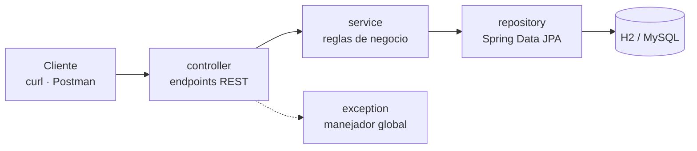

# GestionAp API

**API REST para gestionar habitaciones en alquiler, inquilinos y contratos, con la regla de negocio clave automatizada: al firmar un contrato la habitación queda ocupada y al finalizarlo vuelve a estar disponible.**

[](https://github.com/nelsongomezsa/gestionap-api/actions/workflows/ci.yml)


> **English summary:** REST API (Java 17, Spring Boot 3.3, Spring Data JPA) to manage rental rooms, tenants and contracts. Layered architecture, DTOs, Bean Validation and a global JSON error handler. Creating a contract marks the room as occupied and ending it frees the room again. Runs out of the box on H2 with sample data, with an optional MySQL profile.

---

## Qué resuelve

Es la versión backend de la app de escritorio GestionAp: los mismos datos (habitaciones, inquilinos y contratos), pero expuestos como API para que cualquier cliente, web o móvil, pueda usarlos.

## Funcionalidades

- **Habitaciones** con estado `DISPONIBLE`, `OCUPADA` o `EN_MANTENIMIENTO`, y filtro por estado.
- **Inquilinos** con documento de identidad y email únicos, y teléfono.
- **Contratos** entre una habitación y un inquilino, con filtros por habitación, por inquilino o solo activos.
- **Regla de negocio en el servicio**: crear un contrato exige una habitación disponible y la marca como ocupada; finalizarlo la libera.
- **Errores JSON homogéneos**: `404` si no existe, `409` si hay un conflicto de negocio y `400` si los datos no son válidos.
- **Datos de ejemplo** precargados al arrancar.

## Stack

| Capa | Tecnología |
|---|---|
| Lenguaje | Java 17 |
| Framework | Spring Boot 3.3 (Web, Data JPA, Validation) |
| Persistencia | H2 en memoria (por defecto) · MySQL (perfil `mysql`) |
| Build | Maven |

## Arquitectura



| Paquete | Qué contiene |
|---|---|
| `model/` | Entidades JPA: `Habitacion`, `Inquilino`, `Contrato` |
| `repository/` | Interfaces de Spring Data JPA |
| `service/` | Lógica de negocio y transacciones |
| `controller/` | Endpoints REST |
| `dto/` | Objetos de entrada y salida |
| `exception/` | Excepciones propias y manejador global |

## Cómo ejecutarlo

Requisitos: Java 17 y Maven.

1. **Clona el repositorio**
   ```bash
   git clone https://github.com/nelsongomezsa/gestionap-api.git && cd gestionap-api
   ```
2. **Arranca la API** (H2 en memoria, con datos de ejemplo)
   ```bash
   mvn spring-boot:run
   ```
3. **Pruébala**
   ```bash
   curl "http://localhost:8080/api/contratos?activos=true"
   ```

Consola H2 en `http://localhost:8080/h2-console` (JDBC URL `jdbc:h2:mem:gestionapdb`, usuario `sa`, sin contraseña). Para MySQL, ajusta `src/main/resources/application-mysql.properties` y arranca con `-Dspring-boot.run.profiles=mysql`.

Respuesta real del paso 3 con los datos de ejemplo:

```json
[{"id":1,"fechaInicio":"2026-01-01","fechaFin":null,
  "habitacion":{"id":2,"codigo":"H-102","direccion":"Calle Mayor 12, 1B","precioMensual":480.00,"estado":"OCUPADA"},
  "inquilino":{"id":1,"nombre":"Laura Gomez","documentoIdentidad":"11111111A","email":"laura.gomez@example.com","telefono":"600111222"}}]
```

## Endpoints

| Recurso | Método y ruta | Descripción |
|---|---|---|
| Habitaciones | `GET /api/habitaciones` | Listar (opcional `?estado=DISPONIBLE`) |
| | `GET · PUT · DELETE /api/habitaciones/{id}` | Buscar, actualizar o eliminar |
| | `POST /api/habitaciones` | Crear |
| Inquilinos | `GET /api/inquilinos` | Listar |
| | `GET · PUT · DELETE /api/inquilinos/{id}` | Buscar, actualizar o eliminar |
| | `POST /api/inquilinos` | Crear |
| Contratos | `GET /api/contratos` | Listar (opcional `?activos=true`) |
| | `GET /api/contratos/{id}` | Buscar |
| | `GET /api/contratos/habitacion/{habitacionId}` | Contratos de una habitación |
| | `GET /api/contratos/inquilino/{inquilinoId}` | Contratos de un inquilino |
| | `POST /api/contratos` | Crear (requiere habitación `DISPONIBLE`) |
| | `PATCH /api/contratos/{id}/finalizar` | Finalizar y liberar la habitación |
| | `DELETE /api/contratos/{id}` | Eliminar |

```bash
curl -X POST http://localhost:8080/api/contratos \
  -H "Content-Type: application/json" \
  -d '{"habitacionId":1,"inquilinoId":1,"fechaInicio":"2026-08-01"}'
```

Ejemplo de error:

```json
{
  "timestamp": "2026-08-05T10:15:30",
  "status": 404,
  "error": "Not Found",
  "message": "Habitacion no encontrada con id: 99",
  "path": "/api/habitaciones/99"
}
```

## Tests

```bash
mvn test
```

Por ahora hay **1 test**, que comprueba que el contexto de Spring arranca. La lógica de contratos todavía no tiene tests propios (ver próximos pasos).

## Qué aprendí

- A pasar una app de escritorio a una API REST en capas con Spring Boot.
- A poner las reglas de negocio en el servicio y no en el controlador.
- A devolver errores coherentes con un manejador global y Bean Validation.

## Próximos pasos

- Tests de `ContratoService` (ocupar y liberar habitaciones) y tests de los endpoints con MockMvc.
- Migraciones versionadas con Flyway en lugar de `ddl-auto=update`.
- Documentación con Swagger UI.

Su evolución, con seguridad JWT, roles y app iOS, es [GestionAp PRO API + iOS](https://github.com/nelsongomezsa/gestionapro).

## Autor

**Nelson Gómez Sánchez** · Estudiante de DAM y del Máster en Data & Analytics · [nelsongomezsa.github.io](https://nelsongomezsa.github.io) · [LinkedIn](https://www.linkedin.com/in/nelson-gómez-sánchez)

Licencia [MIT](LICENSE).
